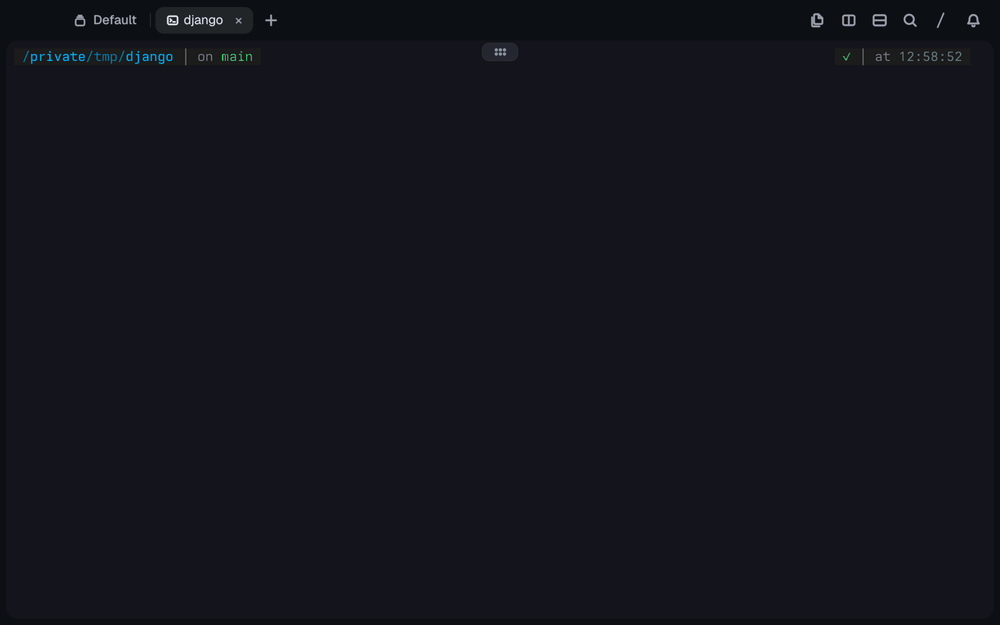
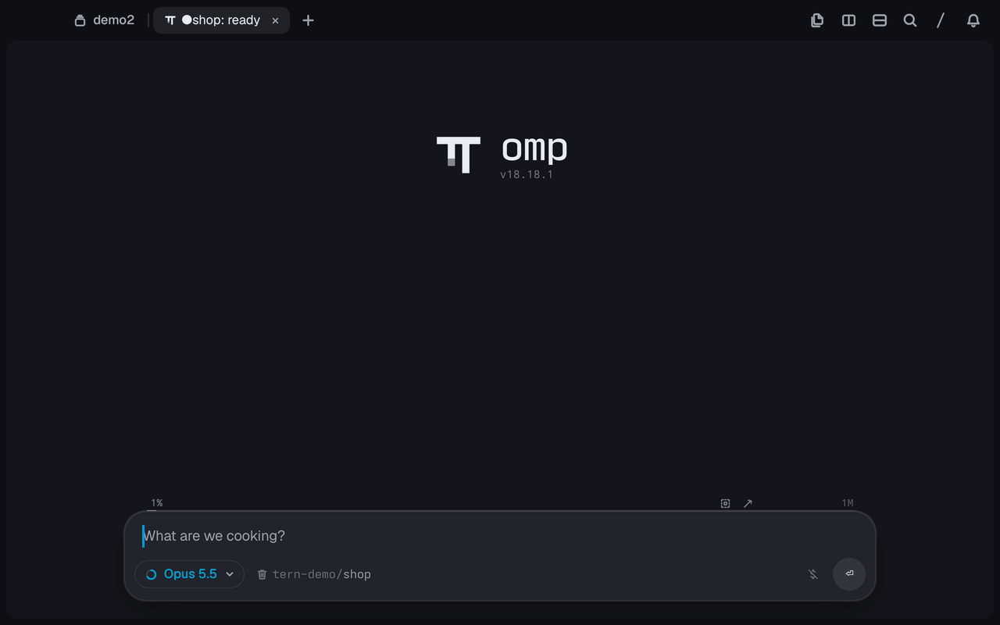
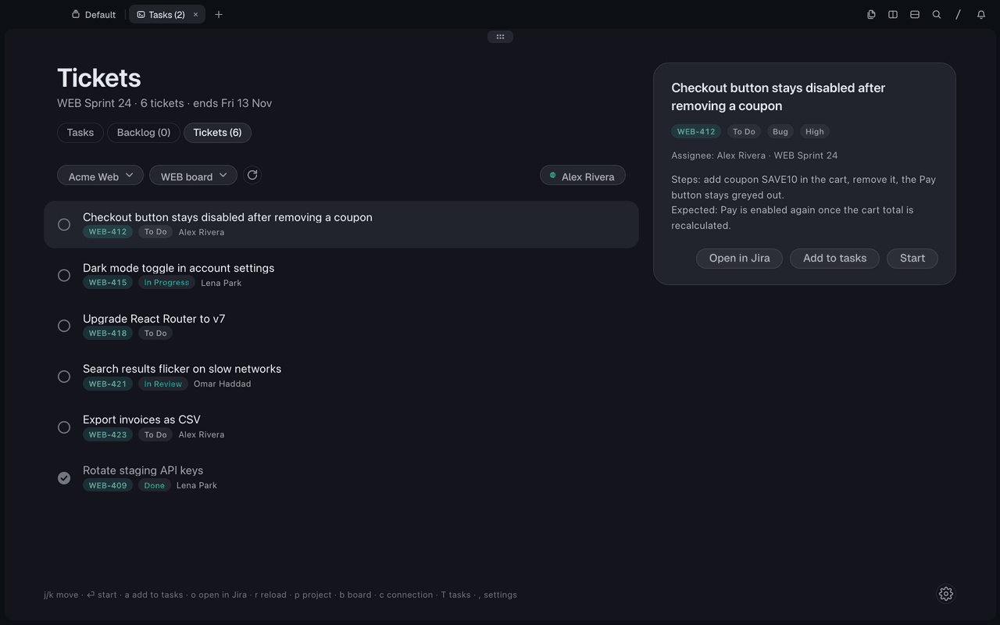
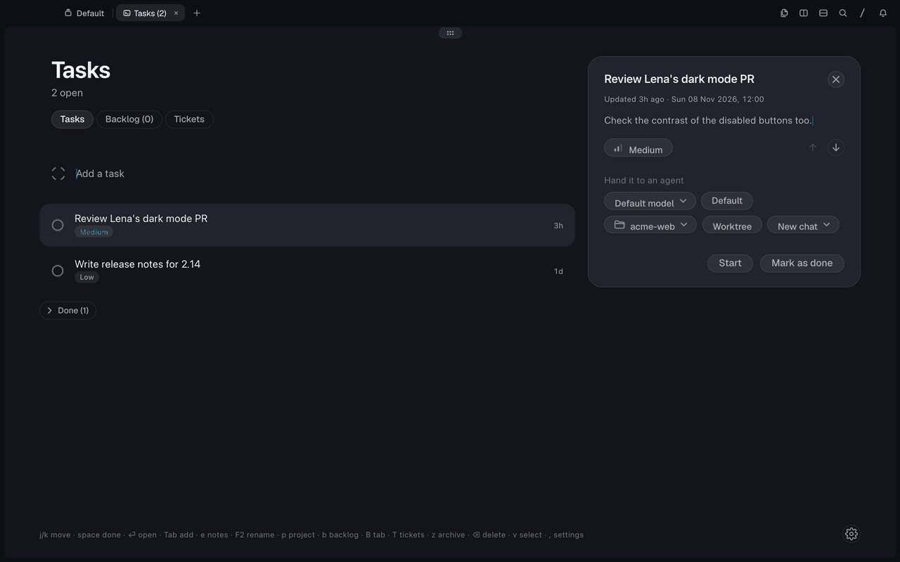

# Tern plugins

Plugins for [Tern](https://docs.stencil.so/tern/), the terminal by Stencil. Each one is a
folder with a `plugin.toml` and Luau sources, installed straight from this repository;
Todo + Jira, a fork of someone else's plugin, keeps its code in its own repository.

<table>
  <tr>
    <td width="50%" valign="top">
      <h3><a href="tern-searcheverywhere">Search Everywhere</a></h3>
      <p>Tap <b>Shift</b> twice and jump to any file, class, function or variable in the
      folder you're in. JetBrains-style matching: <code>fbn</code> → <code>findByName</code>,
      <code>Model.save</code>, <code>views.py:10</code>.</p>
      <a href="tern-searcheverywhere"></a>
    </td>
    <td width="50%" valign="top">
      <h3><a href="tern-testview">Test Explorer</a></h3>
      <p>Finds pytest, unittest, vitest and jest tests, runs them, and shows each failure's
      trace next to the source line. When an agent runs the tests, it opens beside the
      agent and fills in live.</p>
      <a href="tern-testview"></a>
    </td>
  </tr>
  <tr>
    <td colspan="2" valign="top">
      <h3><a href="tern-todo">Todo + Jira</a></h3>
      <p>A to-do list whose tasks open omp agents in Tern panes, with your Jira sprint in a
      Tickets tab. Enter on a ticket starts an agent on it; marking the task done moves the
      issue to Done in Jira.</p>
    </td>
  </tr>
  <tr>
    <td width="50%" valign="top">
      <a href="tern-todo"></a>
      <p align="center"><sub>Start a ticket, mark it done, Jira follows</sub></p>
    </td>
    <td width="50%" valign="top">
      <a href="tern-todo#connect-jira"></a>
      <p align="center"><sub>Connect Jira, pick the project and board</sub></p>
    </td>
  </tr>
</table>

## Install

```sh
tern plugin install github.com/sneaky-bulgarian/tern-plugins/tern-searcheverywhere
tern plugin install github.com/sneaky-bulgarian/tern-plugins/tern-testview
tern plugin install github.com/sneaky-bulgarian/tern-todo
```

`tern plugin list` shows what loaded; `tern plugin remove <id>` takes one out again.
Built and tested with Tern 0.9.12.

| Plugin | Opens with | What it does |
| --- | --- | --- |
| [Search Everywhere](tern-searcheverywhere) | <kbd>⇧</kbd> <kbd>⇧</kbd> | Files and declarations in 17 languages, indexed in the background |
| [Test Explorer](tern-testview) | <kbd>⇧</kbd><kbd>⌘</kbd><kbd>U</kbd>, or by itself when tests run in a pane | Test tree, run all / file / one / failed, traces with source; follows agents' pytest and unittest runs |
| [Todo + Jira](tern-todo) | **Todo: open tasks** in the palette | Tasks that open omp sessions in panes; the active Jira sprint as tickets, closed in Jira when their tasks are done |

## Develop

Link a checkout instead of installing, and Tern reloads the plugin on every save:

```sh
git clone https://github.com/sneaky-bulgarian/tern-plugins
tern plugin link tern-plugins/tern-searcheverywhere
```

`tern plugin types <dir>` writes `tern.d.luau` (already in each folder) for
[luau-lsp](https://github.com/JohnnyMorganz/luau-lsp):

```sh
luau-lsp analyze --platform=standard --definitions=@tern=tern.d.luau *.luau
```

## License

[MIT](LICENSE)
