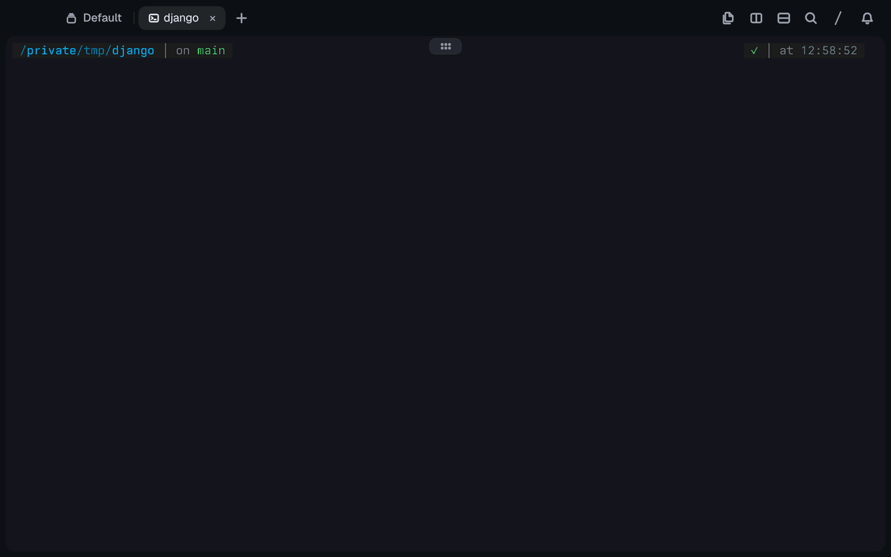

# Search Everywhere

**PyCharm's Search Everywhere, in [Tern](https://docs.stencil.so/tern/).** Tap **Shift twice** and
jump to any file, class, function or variable in the folder you're in.

<p align="center">
  
</p>

<p align="center"><sub>Django's 7,000 files and 52,000 declarations, indexed in about three seconds.</sub></p>

The bar starts as just the scope tabs and the query, and grows to fit the results once there
are some (up to 12 rows, at most three quarters of the tab). Matching works like JetBrains:
`fbn` finds `findByName`, `Model.save` finds a method of a class, `db/models` matches paths
and `views.py:10` opens at line 10.

## Install

```sh
tern plugin install github.com/sneaky-bulgarian/tern-plugins/tern-searcheverywhere
```

## What it searches

- The folder is the focused pane's working directory, or the folder of the file it shows.
- Files come from `git ls-files` (tracked and untracked, without ignored ones) inside a git
  checkout. Elsewhere the folder is walked, skipping hidden directories, `node_modules`,
  virtualenvs and build output.
- Declarations are read from Python, JavaScript/TypeScript, Go, Rust, Lua/Luau, Ruby,
  Java, C#, Dart, Kotlin, Scala, Swift, C/C++, PHP and shell files. Only top-level
  declarations and members of classes, structs, traits and the like count, not locals.

## Use

- **Shift, Shift** (or the palette's **Search everywhere**) opens the overlay. Doing it again
  while it shows closes it. Tern's double-tap shortcuts don't tell left Shift from right,
  so either Shift works; rebind it in Settings › Keyboard.
- Files pane: the search button in its header searches that folder.

| Key | Does |
| --- | --- |
| typing | Filter: `fbn` finds `findByName`, `Model.save` a method in a class, `db/models` a path |
| `name:42` | Open the pick at line 42 |
| ↑ ↓, ⌃P ⌃N, Page Up/Down | Move; ↓ on an empty query lists your last picks in that folder |
| ⏎, double-click | Open the pick (in a file block, at its line) and close the overlay |
| ⇥ / ⇧⇥ | All → Files → Symbols |
| ⌥⌫ / ⌃W, ⌘⌫ / ⌃U | Delete a word, clear |
| Esc, click outside | Close |

Matches rank exact names first, then prefixes, then matches starting at a word or camel
hump, then looser ones; one typed character matches name starts only. The best 100 show.

## How it works

`window.luau` registers the command (default chord `shift>shift`) and the Files pane
button, and opens the `search` block with `how = "glimpse"`. Tern draws a glimpse over the
whole tab and has no selector for one block's glimpse, so while the bar shows the window
half installs a sheet (`tern.css`) that sizes every glimpse and hides its header and
footer, and drops it when the bar closes. The block reports how many list lines it shows
in its title (`Search Everywhere · results 8`), and the window half resizes the sheet on
each `title` event. `host.luau` is the block: the query, ranking and view. `index.luau`
lists and reads files in 25 ms slices so the bar stays live while it indexes, keeps an
index per folder while the host runs (four folders), and rebuilds it in the background
when the bar opens 20 s or more after the last build. `symbols.luau` finds declarations
line by line per language (brace depth or indentation decides what is top level);
`fuzzy.luau` scores names.

Limits: 200,000 files, 500,000 declarations, files up to 1 MiB. Picks on this machine are
opened by the window half so the file takes focus; on a remote host the block opens them.

## Develop

```sh
tern plugin link .          # reloads on every save
tern plugin types .         # tern.d.luau for luau-lsp
luau-lsp analyze --platform=standard --definitions=@tern=tern.d.luau *.luau
```
