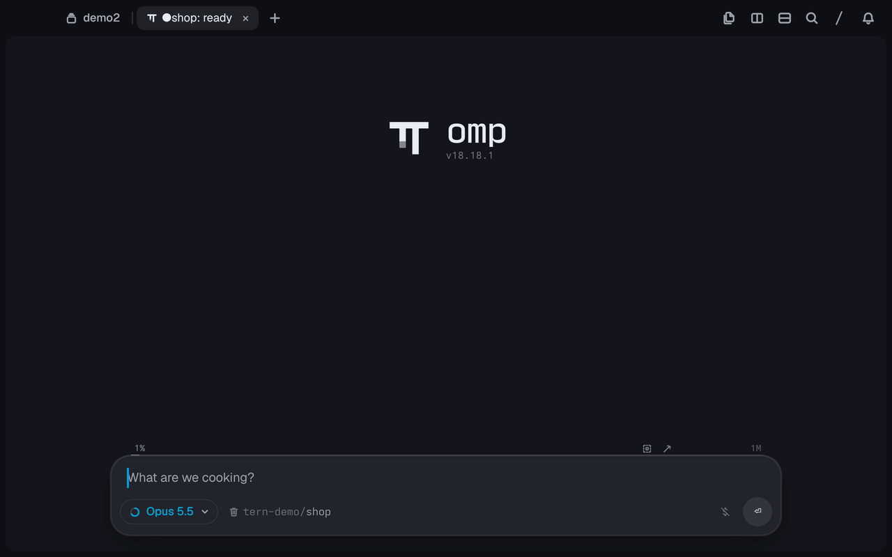
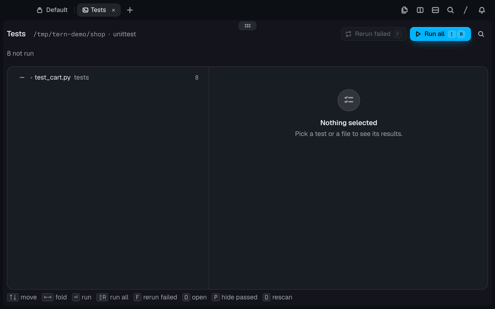

# Test Explorer

**A test runner panel for [Tern](https://docs.stencil.so/tern/).** It finds the unit tests in
a workspace, lists them by file, runs them, and shows each failure's trace next to the
source line. When an agent (or you, in a terminal) runs the tests, the panel opens beside
it and fills in as they run.

<p align="center">
  
</p>

## Install

```sh
tern plugin install github.com/sneaky-bulgarian/tern-plugins/tern-testview
```

## What it runs

- **pytest** and **unittest**: any directory with `pyproject.toml`,
  `pytest.ini`, `setup.cfg`, `setup.py` or `tox.ini` (or the workspace itself
  when nothing else is found). Uses the project's `.venv`/`venv` interpreter
  when there is one, else `python3`. It picks pytest when the project mentions
  it and has it installed, otherwise unittest.
- **vitest** (2 and later) and **jest** (26.5 and later): any `package.json`
  that depends on them, run through `node_modules/.bin`.

The workspace is the git checkout containing the directory you open it from,
searched 4 levels deep (skipping `node_modules`, hidden directories, virtualenvs
and build output).

## Use

- Palette: **Open test explorer** (⇧⌘U) opens it beside the focused pane, for
  that pane's directory.
- Files pane: **Open with Test Explorer** on a test file opens it with that
  file selected.
- **Runs in panes, by agents too**: a pytest or unittest run in a pane opened while the
  plugin is loaded shows in the explorer of its workspace, or opens one beside that pane
  without taking focus. That covers agents running tests through their shell tools
  (tried with omp) and you typing `pytest` in a terminal.
  **Follow test runs in panes (on/off)** in the palette turns it off and on.

<p align="center">
  
</p>

| Key | Does |
| --- | --- |
| ↑ ↓ / j k | Move |
| ← → / h l, Space | Fold and unfold files and suites |
| Enter / r | Run the selected test, file or suite |
| ⇧R | Run everything |
| F | Rerun failed tests (and files that failed to load) |
| O, double-click | Open the test at its line |
| C | Copy the failure |
| P | Hide passed tests |
| X | Stop the run |
| D | Look for suites again |

Clicking a file unfolds it. Clicking a test shows its result on the right: the
error and stack (your frames first, library frames dimmed, the failing line
highlighted in the source), the assertion message or diff, the runner's full
report, and the captured output. Double-click a frame to open it.

Results are kept per workspace in the plugin's data directory, so they come
back the next time the explorer opens.

## How it works

`host.luau` defines the block; `frameworks.luau` finds suites and builds the
runner command lines; `model.luau` holds the tree and applies results;
`view.luau` draws it. Runners report through the helpers in `helpers/`
(`testview_py.py`, `vitest-reporter.mjs`, `jest-reporter.cjs`). Each writes one
JSON event per line to the file `$TESTVIEW_OUT` names, which the block reads
while the run goes on.

Runs in panes report the same events another way. The host's `spawn` hook gives each new
pane `TESTVIEW_WATCH` (a spool directory in the plugin's data) and puts
`helpers/python` first on `PYTHONPATH`. Its `sitecustomize.py` only installs an import
hook: when a process imports pytest's config or unittest's runner,
`testview_watch.py` adds a reporter that writes the run's events to a new file in the
spool. The run's output and exit code don't change, and other Python processes load
nothing more. A `sitecustomize` the environment already has still runs after it.
`window.luau` polls the spool, and when a run starts in a pane this window shows, it
hands the file to the explorer of that workspace or opens one beside the pane. The
explorer follows the file until the run ends (or its process is gone), keeps the
results, and selects the first failure.

Limits: panes opened before the plugin loaded don't report (open a new one), a shell
startup file that replaces `PYTHONPATH` turns it off for that shell, and vitest and jest
runs started outside the explorer are not followed yet.

## Develop

```sh
tern plugin link .          # reloads on every save
tern plugin types .         # tern.d.luau for luau-lsp
luau-lsp analyze --platform=standard --definitions=@tern=tern.d.luau *.luau
```
