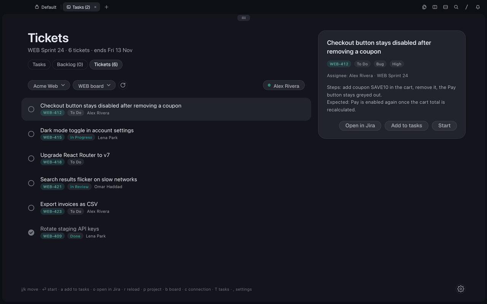
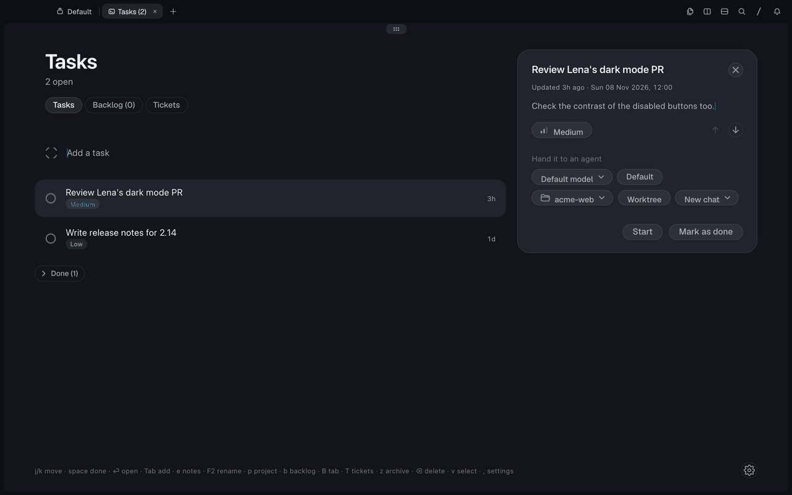
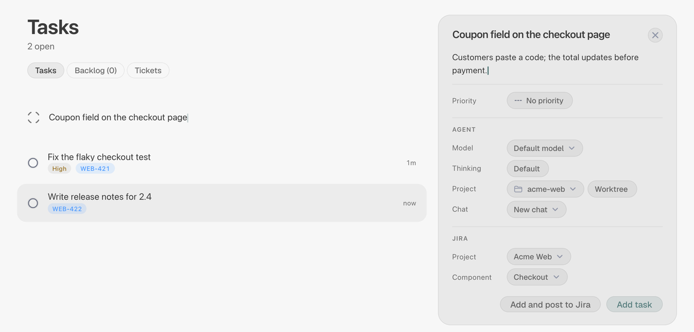

# Todo + Jira

**Your Jira sprint as a to-do list in [Tern](https://docs.stencil.so/tern/).** The Tickets tab
lists your board's active sprint. Enter hands a ticket to an omp agent in a tab of its own,
and when you mark the task done, the issue moves to Done in Jira. A task you write yourself
goes to Jira from its card.

<p align="center">
  
</p>

<p align="center"><sub>A real omp agent; the Jira is a local stand-in with made-up issues.</sub></p>

It is [deLiseLINO/tern-todo](https://github.com/deLiseLINO/tern-todo), the task list whose
tasks open omp sessions in Tern panes, plus Jira, and a fix for Todo blocks in a second
window, whose tasks opened their tabs in the first. The code lives in the fork
[sneaky-bulgarian/tern-todo](https://github.com/sneaky-bulgarian/tern-todo); this folder
holds its docs and demos.

## Install

```sh
tern plugin install github.com/sneaky-bulgarian/tern-todo
```

Open it with **Todo: open tasks** in the palette. To give it a shortcut, bind the action
`plugin.todo-proto.open` in Settings › Keyboard, or in `settings.json`:

```json
"keybinds": { "cmd+alt+t": "plugin.todo-proto.open" }
```

## Connect Jira

<p align="center">
  
</p>

Open the **Tickets** tab (or press `T` on Tasks) and fill in the form:

- **Jira Cloud**: the site URL (`https://your-company.atlassian.net`), your Atlassian email
  and an [API token](https://id.atlassian.com/manage-profile/security/api-tokens). Use
  **Create API token**, not the one *with scopes*: scoped tokens only work through
  `api.atlassian.com`.
- **Jira Data Center**: the server URL, no email, and a personal access token.

Connect checks the credentials against Jira before it saves anything. The token goes to
the system keychain; the URL, email, project and board stay in the plugin's `kv.json`, with
the project and component that tasks post to.
Then pick the project and its board (a project with a single board picks it for you).

## Use

| Key | Does |
| --- | --- |
| ↑ ↓ / j k | Move |
| ⏎, double-click | Start: add the ticket to your tasks and launch omp on it |
| a | Add to tasks without starting |
| o | Open the issue in Jira |
| r | Reload the sprint |
| p, b | Pick the project, the board |
| c | Edit the connection, or disconnect |
| T | Back to Tasks (on Tasks, T opens Tickets) |

- **Start** writes the task (the key and summary as its title, the description and the
  issue link as notes) and launches it like any other task: omp gets them as its prompt
  and runs in the last project you used, in a new git worktree while **Create new chats in
  a worktree** is on. To pick the project or model first, add the ticket with `a`.
- Each row shows the issue's Jira status and assignee, and once the ticket has a task,
  that task's agent status: Working, Needs you, Ready for you.
- **Done goes back to Jira.** When a linked task turns done (its check, space, **Mark done**
  on a selection, or closing its pane), the issue moves to a done status: a transition
  named Done, Closed or Resolved first, with a resolution when the workflow requires one.
  An issue that is already done is left alone. If Jira refuses, a toast says why and the
  ticket's card offers **Close in Jira**.

## Post a task to Jira

<p align="center">
  
</p>

The task card lays its controls out in labelled rows: the task's priority, then the agent
that runs it (model, thinking level, project folder, chat), then Jira. While Jira is
connected, an open task without an issue gets two Jira rows:

- **Project** and **Component** say where the issue goes. With nothing saved, they
  preselect the Tickets tab's project (else the first project Jira lists) and that
  project's first component. Your first pick, or your first post, becomes the default and
  stays until you pick another. Each project keeps its own component; **No component** is a
  choice too.
- **Post to Jira** creates the issue: the title is its summary, the notes its description,
  and its type is Task (else the project's first standard type). The task is then linked:
  its card and row show the key, and marking it done closes the issue like any linked task.
- A new task's card takes notes too. **Add and post to Jira** adds the task and posts it in
  one go; **Add task** (or Enter in the add row) only adds it.

If Jira refuses, say for a required field, a toast quotes its reason and the task stays local.

## How it works

Host halves can't reach the keychain, so the window half, `jira.luau`, talks to Jira. The
block asks with `cx:open("todo-jira:<op>?…")`, a link only this plugin's window claims
(`jira-link.luau`), and the window answers with a `todo.jira` event. Links never carry the
token: Connect reads it off the block's masked field. The calls are REST v2 and Agile 1.0,
which Cloud and Data Center both serve: `myself` to check the sign-in, `project/search`,
`board?projectKeyOrId=`, `board/{id}/sprint?state=active`, `sprint/{id}/issue` and
`issue/{key}/transitions`; posting adds `project/{key}/components`,
`project/{key}?expand=issueTypes` and `POST issue`. Requests time out after 20 s; lists stop
at 20 pages of 50. Every window of the block's window key gets its links, so the first one
to take a post claims it in `kv.json` and the issue is created once.

Linked tasks keep `"jira": {"key": "WEB-412", "url": "…/browse/WEB-412"}` in the task file.
The done hook sits in the plugin's file writer, so it fires once for each task that turns
done, whatever turned it.

Limits: Kanban boards have no sprints, the tab needs an open Tern window, and edits to the
task file by hand don't reach Jira.

## Develop

```sh
git clone https://github.com/sneaky-bulgarian/tern-todo
tern plugin link tern-todo          # reloads on every save
tern plugin types tern-todo         # tern.d.luau for luau-lsp
```
